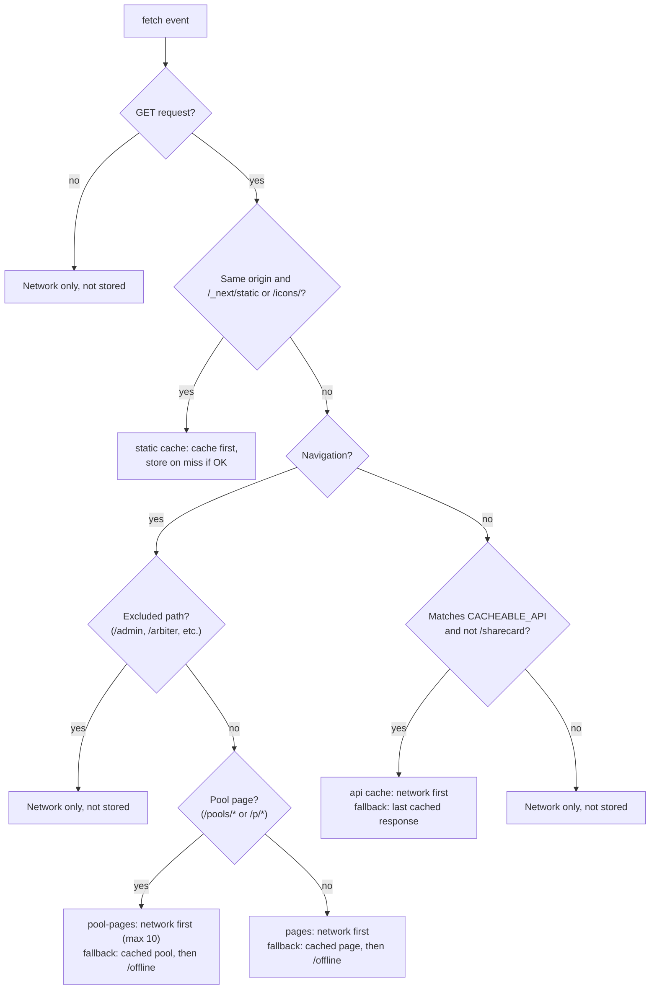

# PWA caching strategy

The service worker is [`public/sw.js`](../public/sw.js). The rules and their reasons are in [ADR 0002](decisions/0002-pwa-and-performance-budget.md). If you change `sw.js`, update the table and the diagram in the same PR.

Line numbers below refer to `public/sw.js` on `main`.

## Route table

| Request | Strategy | Cache | Code | Cleared when |
|---|---|---|---|---|
| Any non-GET request (POST, PUT, ...) | Not handled by the worker; goes straight to the network | none | lines 70-71 | never cached |
| Same-origin `/_next/static/*` and `/icons/*` | Cache first. On a miss, fetch and store the response if it is OK | `static-${BUILD_ID}` | lines 75-78 | a `BUILD_ID` bump removes it on `activate` (lines 20-27) |
| Pool page navigations (`/pools/*`, `/p/*`) | Network first. On success: cached in bounded cache (max 10). On failure: cached pool page, then `/offline` | `pool-pages-${BUILD_ID}` | lines 86-90 | sign-out posts `CLEAR_API`; a `BUILD_ID` bump |
| Other page navigations (excluding admin, arbiter, etc.) | Network first. On failure: cached page, then `/offline` | `pages-${BUILD_ID}` (`/offline` precached on install) | lines 92-94 | a `BUILD_ID` bump |
| GET `/v1/pools...`, `/v1/p...`, `/v1/offers...` (regex), except paths containing `/sharecard` | Network first. On failure: last cached response | `api-${BUILD_ID}` | lines 97-99 | sign-out posts `CLEAR_API`; a `BUILD_ID` bump |
| Everything else: admin, arbiter, `/v1/tx`, `/v1/auth`, `/v1/me`, wallets, uploads, evidence | Not handled by the worker; goes to the network | none | excluded | never cached |

Network-first responses are stored only when `res.ok` is true and `res.status === 200`. The fallback order on a network failure is: the cached copy of this request, then (for navigations only) `/offline`, then a network error.

## Request flow

## Sign-out and versions

- On sign-out the app posts the string `CLEAR_API` to the worker. The worker then deletes both `api-${BUILD_ID}` and `pool-pages-${BUILD_ID}`, ensuring no cached pool views or documents carrying user commitments persist after sign-out.
- `BUILD_ID` is part of every cache name. Bumping it makes the next `activate` delete all old caches not in `CURRENT_CACHES`.

## Testing in Chrome DevTools

Use a production build (`pnpm build && pnpm start`). Register and check the worker from a clean profile.

1. **Application > Service Workers.** Confirm that `sw.js` is activated and running. Tick **Update on reload** while you work.
2. **Application > Cache Storage.** Visit a public pool page. Expect `static-v1` and `pages-v1` to exist, and `api-v1` to hold the `/v1/pools` or `/v1/p` response. Expect `pages-v1` to contain `/offline`.
3. **Offline shell.** Tick **Network > Offline** and reload the pool page. It should render from cache. Open a page you have never visited while offline. It should show `/offline`.
4. **Never cached.** Submit an action, then check Cache Storage. No `/v1/tx`, `/v1/auth`, `/v1/me`, upload or evidence response should appear in any cache. A `/sharecard` URL should not appear in `api-v1`.
5. **Sign-out.** Sign out, then check that `api-v1` is gone or empty.
6. **Version bump.** Change `VERSION`, reload, and confirm that the old `*-v1` caches are removed after the new worker activates.

## Review checklist for changes to `sw.js`

- [ ] The table above matches the code, line numbers included
- [ ] The diagram matches the table
- [ ] Nothing that carries credentials or moves money is cached
- [ ] `CLEAR_API` still clears everything a signed-in user can see
- [ ] The Lighthouse JavaScript budget in [ADR 0002](decisions/0002-pwa-and-performance-budget.md) is not affected by the worker
